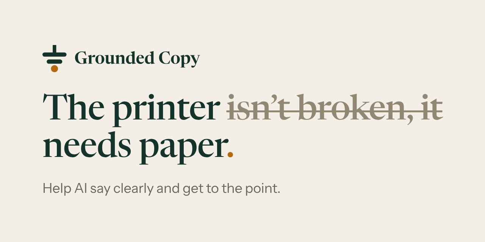

# Grounded Copy website

The website of [Grounded Copy](https://github.com/HiroHyun/grounded-copy), a plugin that helps AI
agents say things clearly and get to the point.

**[Visit the site](https://hirohyun.github.io/groundedcopy/)** · [中文版](https://hirohyun.github.io/groundedcopy/zh/)

On the site you can switch the plugin on one sentence at a time, watch 300 everyday questions
answered with it and without it, and download the full record of that run.

## Credits

- Pictures: four prints from the Art Institute of Chicago, in the public domain.
- Fonts: Newsreader, Instrument Sans, IBM Plex Mono, Noto Serif SC and Noto Sans SC, under the
  SIL Open Font License.
- Icons: [Lucide](https://lucide.dev), under the ISC License.
- The OpenAI logo belongs to OpenAI, and Claude Code to Anthropic. This website is an
  independent project.

## License

The code is under [AGPL-3.0-only](LICENSE), the same licence as the plugin. The fonts, icons,
pictures and logos keep their own licences, listed above, and the Grounded Copy name and mark
are not covered by it.
